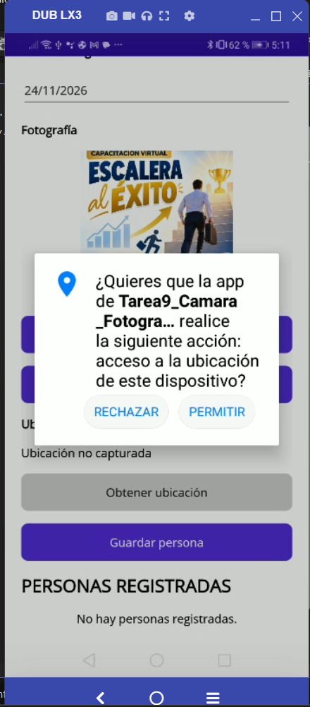
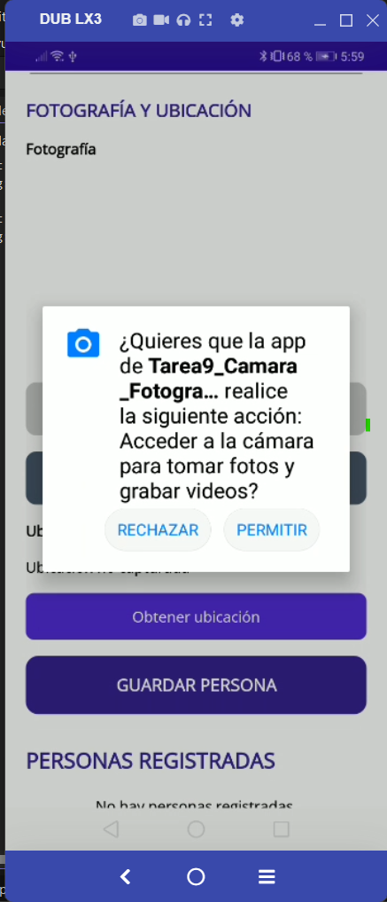
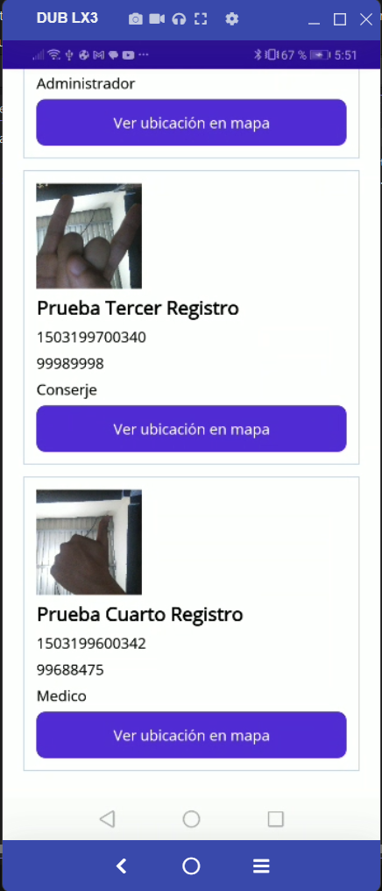
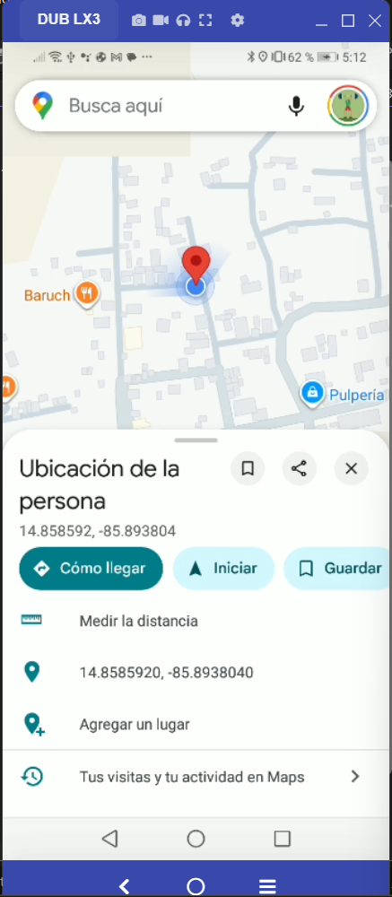

# Tarea 9: Cámara, fotografía y geolocalización

## Descripción

Aplicación móvil desarrollada con .NET MAUI para el registro de personas, integrando funciones de cámara, selección de fotografías desde la galería y geolocalización mediante GPS.

## Tecnologías utilizadas

- C#
- .NET MAUI
- SQLite
- CommunityToolkit.Mvvm
- Microsoft.Maui.Controls.Maps
- Visual Studio

## Funcionalidades

- Registro de personas con identidad hondureña de 13 dígitos.
- Validación de los datos ingresados.
- Prevención de registros duplicados.
- Almacenamiento local mediante SQLite.
- Captura de fotografías utilizando la cámara del dispositivo.
- Selección de fotografías desde la galería.
- Obtención de coordenadas mediante GPS.
- Visualización de ubicaciones mediante Google Maps.
- Listado de personas registradas con sus fotografías.

## Evidencias de funcionamiento

### 1. Solicitud de permiso de ubicación

### 2. Solicitud de permiso de cámara

### 3. Fotografía en el registro

### 4. Ubicación en Google Maps

## Pruebas realizadas

- Validación de identidad duplicada.
- Validación de campos obligatorios.
- Persistencia de los registros después de cerrar y abrir la aplicación.
- Captura y selección de fotografías.
- Obtención de coordenadas GPS.
- Apertura de Google Maps desde una persona registrada.

## Dispositivo de prueba

Huawei DUB-LX3 con Android 8.1.

## Autor
Grupo #3
Tarea 9.